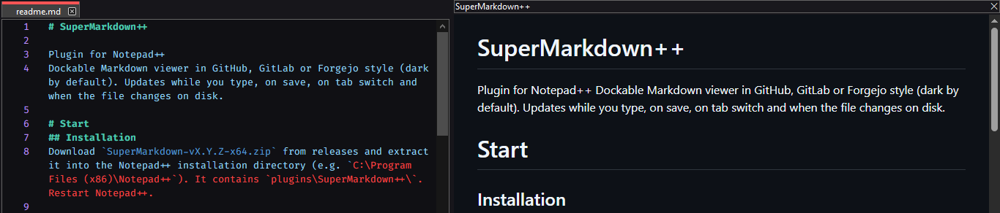

# SuperMarkdown++

Dockable Markdown viewer for Notepad++ in GitHub, GitLab or Forgejo style.

# Installation
1. Download `SuperMarkdown-vX.Y.Z-x64.zip` from releases and extract it into the Notepad++ installation directory (e.g. `C:\Program Files (x86)\Notepad++`). It contains `plugins\SuperMarkdown++\`.
2. Restart Notepad++.

# Usage
The viewer is dark by default. It updates while you type, on save, on tab switch and when the file changes on disk.

Plugins > SuperMarkdown++:

| Item | Action |
| --- | --- |
| Toggle SuperMarkdown++ | Hide, or show again in the last used dock mode (`Ctrl+Alt+Shift+Down`) |
| Cycle Dock Mode | Hidden, Sidebar, Replace Editor (`Ctrl+Alt+Shift+Up`) |
| Cycle Theme | Dark, Light (`Ctrl+Alt+Shift+Left`) |
| Cycle Style | GitHub, GitLab, Forgejo (`Ctrl+Alt+Shift+Right`) |
| Hidden / Sidebar / Replace Editor | Set the dock mode (the active one is checked) |
| Dark Theme / Light Theme | Set the theme (the active one is checked) |
| GitHub Style / GitLab Style / Forgejo Style | Set the rendering style (the active one is checked) |

Shortcuts are changeable in Settings > Shortcut Mapper > Plugin commands. They also work while the viewer has focus, with the default keys only. `Ctrl+Shift+arrows` are not used: Notepad++ uses them for moving lines and selecting words.

Mode, theme and style apply instantly and are remembered in `%LOCALAPPDATA%\SuperMarkdown++\` (`mode.txt`, `shown.txt`, `theme.txt`, `style.txt`).

# View modes
| Mode | Notes |
| --- | --- |
| Hidden | Editor only |
| Sidebar | Docked panel, can be dragged to any side |
| Replace Editor | Viewer covers the text of the active view and its scrollbars are hidden. The tab bar stays usable. Switch to Hidden or Sidebar to edit |

# Styles
| Style | Notes |
| --- | --- |
| GitHub | Default |
| GitLab | GitLab-like fonts, headings, tables, code blocks |
| Forgejo | Forgejo/Gitea markup: README box with file header, heading anchors, code copy button, attention-style alerts |

GitLab and Forgejo are approximations built from their public stylesheets and are not pixel-exact. The Forgejo CSS and colors are ported from Gitea, not from Forgejo's own source.

# How it loads
`SuperMarkdown++.dll` (C, `shim\shim.c`) is what Notepad++ loads. It starts .NET via hostfxr and calls `SuperMarkdown.dll`. Startup problems show a message box. The plugin folder name must equal the DLL name, `SuperMarkdown++`.

# Notes
- Code highlighting loads highlight.js from cdnjs; offline, code blocks render unhighlighted.
- Relative images resolve against the file's folder.
- Relative links (`[MIT](LICENSE.md)`, `docs/guide.md#usage`, `../readme.md`) open the file in Notepad++, and the viewer renders it when it is Markdown. Files are opened, never run. `#anchor` links scroll in place.
- External links open in the default browser.
- Only `.md/.markdown/.mdown/.mkd/.mkdn/.mdx/.rmd` and unsaved tabs are rendered. On other files the panel hides itself and returns on the next Markdown tab.

# Building
Requirements:
- Notepad++ 64-bit
- .NET 8 SDK (`global.json` pins 8.0.x) and the .NET 8 Desktop Runtime (x64)
- 64-bit MinGW-w64 `gcc` on PATH, e.g. w64devkit (`gcc -dumpmachine` prints `x86_64-...`). If it is not on PATH, `build.bat` also looks in `%W64DEVKIT%`, `C:\w64devkit` and `w64devkit` in your user, Downloads and Desktop folders.
- Microsoft Edge WebView2 Runtime, version 120 or newer (preinstalled and auto-updated on current Windows)

Run `build.bat [-c] [-i] [-r] [-n] [-h]`. Flags combine in any order, e.g. `build.bat -cir`.

| Flag | Action |
| --- | --- |
| `-c` | Clean: delete `bin` and `obj` first |
| `-i` | Install: copy the build to `Notepad++\plugins\SuperMarkdown++`, found via `%NPP_DIR%`, `%ProgramFiles%\Notepad++` or `%ProgramFiles(x86)%\Notepad++` (Notepad++ must be closed, run as administrator under Program Files) |
| `-r` | Release: package the build into `release\SuperMarkdown-vX.Y.Z-x64.zip` (contains `plugins\SuperMarkdown++\`) and `release\SHA256SUMS.txt`; the version comes from `<Version>` in `SuperMarkdown++.csproj` |
| `-n` | Nobuild: skip the build and reuse the existing output (needs `-i` and/or `-r`, not with `-c`) |
| `-h` | Show help: flags and the resolved build output, install and release paths, no build |

Build output: `bin\Release\net8.0-windows\`

# License
- [MIT](LICENSE.md)
- Markdig (BSD-2-Clause)
- Microsoft.Web.WebView2 (BSD-3-Clause)
- Gitea (MIT)
